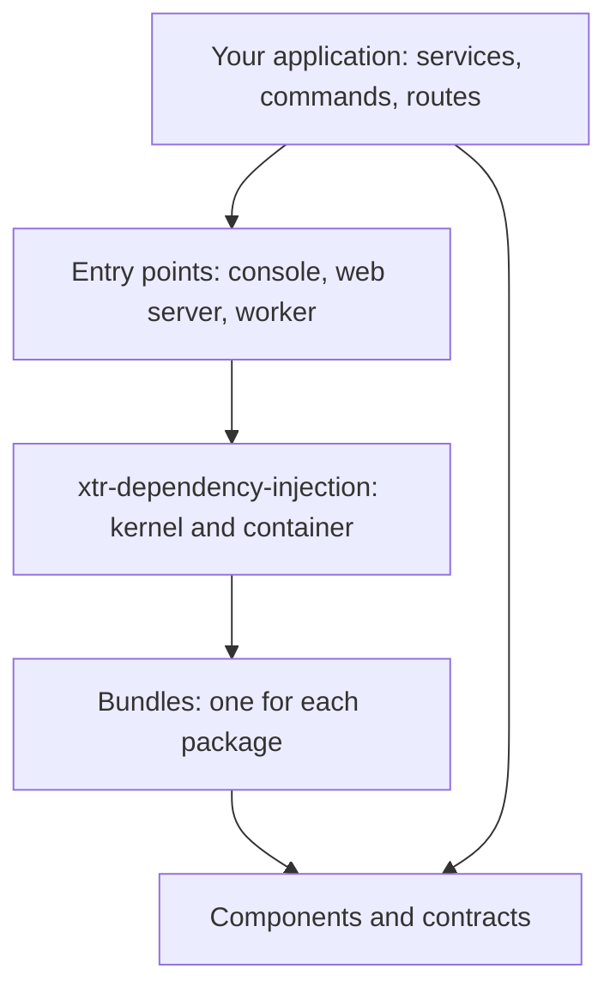

# Architecture

This page describes how the xtr packages connect. It describes the three types
of package, the layers of an application, and the life of a kernel.

## Three types of package

Each xtr package has one of three types.

| Type | What it contains | Example |
|---|---|---|
| Component | A library that does one job. It works with no container. | `xtr-cache`, `xtr-messenger` |
| Contracts | Only the interfaces of a component. It has no implementation. | `xtr-cache-contracts` |
| Bundle package | The bundle of a family of components. It configures and connects them. | `xtr-security` |

Most components also contain a bundle, in the subpackage `<package>.bundle`.
The bundle connects the component to the container. A family of components,
for example the security components, has one bundle package for all the family.

## The layers of an application

An application has four layers. Each layer uses only the layers below it.

1. **Components and contracts.** These packages do the work. They do not know
   about the container.
2. **Bundles.** Each bundle tells the container how to make the services of its
   package. It reads a configuration object.
3. **The kernel.** The kernel collects the bundles and their configuration.
   Then it builds the container.
4. **Entry points.** An entry point builds and starts a kernel. Then it runs a
   console command, serves a web application or receives messages.

Your code uses the services of the components. The container gives these
services to your code through the parameters of your functions and classes.

## The life of a kernel

The kernel does its work in steps. The `Kernel(...)` call stores the settings
only. Each later call does the work again, from the start.

| Call | What it does |
|---|---|
| `Kernel(__package__, ...)` | Stores the settings of the kernel. It does no work. |
| `kernel.build()` | Reads the bundles, scans the application and compiles the container. |
| `kernel.boot()` | Builds the container, then runs the `boot()` hook of each bundle and each `@on_boot` function. |
| `kernel.run(main)` | Boots the kernel, calls `main`, shuts down the kernel and returns the exit code of `main`. |

Two kernels in one process share no container. Thus, a test can build a kernel
with a different configuration from the kernel of the application.

## The environment

The kernel reads the name of the environment from the `APP_ENV` variable. The
default is `dev`. The `allowed_envs` argument of the kernel lists the names that
the application accepts.

The environment selects these items:

- The bundles that are active. `config/bundles.py` maps each bundle to its
  environments.
- The configuration functions and the services that have the `@when` decorator.
- The environment directories of the configuration. The kernel imports
  `config/packages/dev/` and `config/routes/dev/` only in the `dev`
  environment, after the other configuration files.

## More information

- [Bundles](bundles.md) describes a bundle and its configuration.
- [Contracts](contracts.md) describes why the contracts packages exist.
- The
  [xtr-dependency-injection README](https://github.com/xterr/python-xtr/tree/main/packages/xtr-dependency-injection)
  describes the kernel and the container in full.
- The [dependency graph](https://github.com/xterr/python-xtr#packages) in the
  repository README shows the dependencies of each package.
